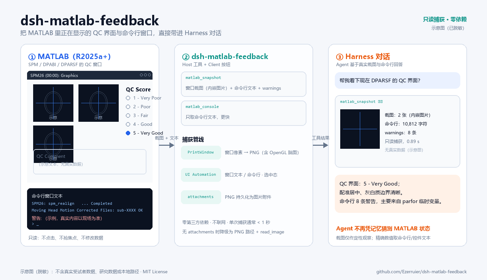

# dsh-matlab-feedback

[](https://github.com/Ezerruier/dsh-matlab-feedback/actions/workflows/ci.yml)
[](https://github.com/Ezerruier/dsh-matlab-feedback/releases)
[](LICENSE)
[](https://github.com/Ezerruier/dsh-matlab-feedback)

**MATLAB 实时反馈 · DeepSeek Harness 插件**

把正在运行的 MATLAB 桌面（含 DPABI / DPARSF / SPM 的 QC 窗口）的**真实窗口截图**和**命令行窗口文本**直接取进 DeepSeek Harness 对话，让你可以直接问 Agent：

> “看一下现在 DPARSF 的 QC 界面，这个配准/阈值结果有什么问题？”

Agent 拿到的是真实截图 + 当前命令行输出，而不是凭记忆猜测。



> 示意图为流程示意，使用虚构文本绘制，不含真实受试者数据、研究数据或本地路径。

---

## 功能

| 能力 | 说明 |
| --- | --- |
| `matlab_snapshot` 工具 | 抓取所有可见 MATLAB 窗口：截图作为**图片附件**内嵌在工具结果中，同时返回窗口清单、命令行窗口文本（尾部）、警告/错误摘要 |
| `matlab_console` 工具 | 只读命令行窗口文本，参数 `lines`（10–400，默认 120）；不截图、更快 |
| 输入框按钮 | 聊天输入框左侧的「MATLAB 快照」按钮：点击后向输入框插入一条预置提示词，补充问题后发送即可 |
| 捕获引擎 | `scripts/matlab-feedback.ps1`（Windows PowerShell 5.1）：Windows UI Automation 读取 CEF 桌面/图窗文本，`PrintWindow` 截图，输出 `manifest.json` + PNG |
| 只读、无侵入 | 不点击、不键入、不抢焦点、不移动/恢复窗口、不修改 MATLAB/SPM/DPABI 数据，也不安装任何 MATLAB 侧代码 |

**不需要官方 MATLAB MCP，不需要 MATLAB 里运行任何脚本，不需要改 MATLAB 设置。**

## 架构

```text
Agent 工具 matlab_snapshot / matlab_console
        │
        ▼
Host 半侧 (index.mjs)：创建 run 目录 → spawn PowerShell 捕获脚本 → 解析 manifest
        │                                   │
        │                                   ▼
        │                      PrintWindow(hwnd, PW_RENDERFULLCONTENT) → PNG
        │                      UI Automation：窗口文本 / 命令行窗口文本 / 单选状态
        │                                   │
        ▼                                   ▼
attachments.saveImage → 工具结果内嵌图片块   <workspace>/.dsh-matlab-feedback/<runId>/
        │
        ▼
Client 半侧 (client.js)：输入框「MATLAB 快照」按钮 → inputActions.insertText 预置提示词
```

## 安装

前置条件：

- Windows 10/11，Windows PowerShell 5.1（系统自带）；
- MATLAB **R2025a 及以上**（桌面为 CEF 渲染，才能读文本；更老版本只能截图）；
- DeepSeek Harness Desktop / `dsh` 0.2.1-rc 系列 profile（开发验证：0.2.1-rc.3）。

安装方式（任选其一）：

1. 使用 DSH 的插件管理器安装本目录（`plugin_manager` 的 `install_bundle`，target 指向本目录绝对路径）；
2. 手动复制到 profile 并加入 `package.json` 的 `dsh.profile.bundles`（不推荐）。

安装后无需重启：工具 `matlab_snapshot` / `matlab_console` 出现在 Agent 工具表，输入框左侧出现「MATLAB 快照」按钮。若页面未刷新出按钮，刷新一次页面。

## 使用

### 对 Agent

```text
matlab_snapshot            # 截图 + 命令行 + warnings（0.3–3 秒，取决于 MATLAB 负载）
matlab_console {lines: 80} # 只取命令行尾部 80 行（更快）
```

`matlab_snapshot` 返回内容：

- 最多 4 张窗口截图（优先级 `qc-figure > pipeline-gui > figure > desktop`），以图片附件内嵌；
- 窗口清单：角色、标题、尺寸、是否最小化、文本来源与摘要；
- 命令行窗口文本尾部（默认 ≤6000 字符，超限注明截断并给出完整 `manifest.json` 路径）；
- warnings：从命令行/窗口文本提取的警告、错误行（去重，≤40 条）。

### 对用户

点击输入框左侧 **MATLAB 快照** 按钮，输入框会插入：

> 请调用 matlab_snapshot 抓取当前 MATLAB 的窗口截图和命令行窗口，概述你看到的界面状态（若在 DPARSF QC 流程，说明 QC 界面的关键信息），然后回答我的问题：

补充你的问题后回车发送即可。

## 安全与隐私

- **只读捕获**：只做窗口枚举、`PrintWindow` 截图和 UI Automation 文本读取；不点击、不键入、不切换焦点、不移动/恢复/关闭窗口、不终止 MATLAB 进程。
- **不联网**：插件自身不发起任何网络请求；截图/文本只写入本机磁盘与当前 Harness 会话。
- 截图包含窗口当前显示的像素，**可能含研究数据、受试者编号、本地路径**；命令行文本也可能含路径与报错。它们会作为工具结果进入当前会话，并随模型请求发送给所配置的模型服务商——分享会话记录或截图前请自行评估敏感性。
- 每次捕获在工作区 `.dsh-matlab-feedback/<runId>/` 下写 `manifest.json` 与 `w-*.png`；历史 run 目录最多保留 20 个，旧的自动清理。

## 已知限制

- 仅 Windows；依赖 Windows PowerShell 5.1 与 .NET UI Automation。
- 文本读取依赖 MATLAB R2025a+ 的 CEF 桌面；老版本 MATLAB 或 `-batch`/`-nodisplay` 无窗口模式只有截图（若仍有窗口），没有文本。
- 最小化到任务栏的窗口不截图（避免恢复窗口打扰用户），但尽量读取文本。
- MATLAB 对超长行会显示“输出已截断。文本超出命令行窗口显示的最大行长度。”，这是上游限制。
- 个别超链接文本会被 UI Automation 拼出 `link … out of link` 之类的装饰噪声，不影响信息本身。
- 单个窗口截图失败不会导致整次捕获失败（该窗口 `screenshot: null`）。
- 若当前会话没有 attachments 服务，工具降级为纯文本并给出 PNG 绝对路径，Agent 可用 `read_image` 读取。

## 开发与测试

纯 Node（无第三方依赖），捕获脚本为 Windows PowerShell 5.1。CI 由 GitHub Actions 执行（Node 22/24）：语法检查、JSON 校验与单元测试。

```bash
node --check index.mjs
node --check client.js
node --test tests/host/unit.test.mjs      # 27 个 fixture 单测，不需要 MATLAB
node tests/host/dry-run.mjs               # 真实 MATLAB 端到端 dry-run（需要 MATLAB 已打开）
powershell -NoProfile -ExecutionPolicy Bypass -File tests/capture/smoke-test.ps1
```

- `tests/host/`：Host 逻辑单测（参数拼装、manifest 归一化/降级、图片选取、渲染格式、超时/退出码、run 目录清理）；
- `tests/capture/smoke-test.ps1`：对当前 MATLAB 做一次真实只读捕获并校验 `manifest.json` 与 PNG 尺寸；
- `docs/DESIGN.md`：捕获原理、manifest 契约、工具/Client 契约与设计取舍。

## 许可证与声明

MIT License，见 [LICENSE](LICENSE)。版本更新记录见 [CHANGELOG.md](CHANGELOG.md)。

本项目是社区插件，与 MathWorks、DeepSeek 均无隶属关系。MATLAB® 是 The MathWorks, Inc. 的商标；DeepSeek Harness 为 DeepSeek 的产品。使用时请自行遵守 MATLAB 许可条款与所在机构的数据管理规定。
